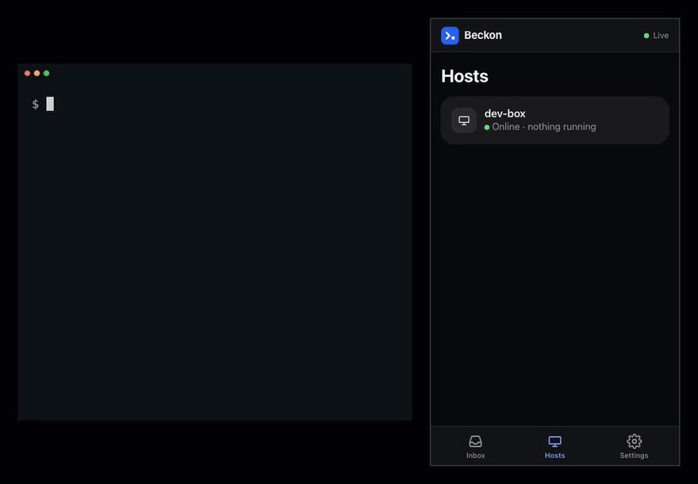

# Beckon

[](https://github.com/jaystewartuk/beckon/actions/workflows/ci.yml)
[](https://github.com/jaystewartuk/beckon/actions/workflows/security.yml)
[](https://github.com/jaystewartuk/beckon/releases)
[](https://scorecard.dev/viewer/?uri=github.com/jaystewartuk/beckon)
[](NOTICE)

**A remote inbox for terminal agents.** Beckon shows the live state of every coding agent and long-running
terminal job on all your machines, sends a push notification to your phone when one is blocked waiting for
you, and lets you approve or deny it with one tap. Message content is end-to-end encrypted: the server routes
records but cannot read them, and nothing types into your terminal unless a device you paired signed for it.

It works with any program: tools that speak the [OSC 7501](https://mitchellh.com/writing/program-status-osc7501) terminal
status protocol report their own state; for others the helper spots known prompts on screen (built in: Claude
Code, Codex CLI, Gemini CLI, GitHub Copilot CLI, Cursor CLI and OpenCode), and agents' own hooks can report when they are
working or done. Setup per agent: [docs/agents.md](docs/agents.md).



## Quick start

```sh
curl -fsSL https://beckoncli.com/install.sh | sh    # installs the beckon helper to ~/.local/bin, no sudo
beckon login                                       # approve this host in the browser
beckon setup                                       # add hooks to the coding agents installed here
beckon run -- claude                               # or any command: beckon run -- make test
```

Then open https://beckoncli.com on your phone and sign in. The setup guide installs the app, turns on
notifications and pairs your phone with the host on the same page (run `beckon pair`, tap Pair, and compare
the six words). The next time the agent needs you, your phone buzzes. Sessions show under the title the agent gives
its terminal, or the folder and branch; `beckon run --name WEBSHOP -- claude` picks the name yourself.

The installer checks the download's SHA-256, and its cosign signature when `cosign` is installed. Prefer to
read it first? `curl -fsSL https://beckoncli.com/install.sh -o install.sh`. Binaries for macOS and Linux
(amd64, arm64) are also on the [releases page](https://github.com/jaystewartuk/beckon/releases).

**Run agents on a server instead of your laptop:** [docs/devbox.md](docs/devbox.md) sets up an always-on
Ubuntu box with the agents, tmux, Tailscale and Beckon. Start an agent, close the laptop, and approve from
your phone. `devbox/launch --chain` runs a plan of milestone prompts there, one fresh session after another,
and asks your phone only when a stage needs a decision from you. No server? `devbox/local chain` runs the
same chain on your own computer, in a Docker sandbox with none of your files or credentials and a network
limited to the domains you allow.

## How it works

```
 your terminal                      Beckon server                      your phone / browser
┌──────────────────┐  encrypted   ┌──────────────────────┐  encrypted  ┌────────────────────┐
│ beckon run -- …  │ ───────────▶ │ routes records,      │ ──────────▶ │ inbox (PWA),       │
│  PTY + OSC 7501  │  WebSocket   │ sends Web Push,      │  WebSocket  │ push notifications │
│  parser, detector│ ◀─────────── │ cannot read content  │ ◀────────── │ signed approve/deny│
└──────────────────┘ signed reply └──────────────────────┘             └────────────────────┘
```

- **`beckon` helper** (Go, `helper/`): wraps a command in a PTY, passes all input and output through
  untouched, and reports `working`, `blocked`, `done` or `error`. It encrypts message text to your paired
  devices before it leaves the machine.
- **Server and web app** (Next.js, `ws` and Postgres, `web/`): stores and fans out records, applies the
  notification rules (quiet hours, rate limits), and serves the installable web app.
- **Responses:** buttons appear only for prompts you opt in to per app. The helper types an answer only if it
  offered that option itself and the answer is signed by a device in its local trusted list.

More: [docs/architecture.md](docs/architecture.md), and the original [product spec](SPEC.md).

## How it compares

- **Claude Code's Remote Control** pushes Claude Code sessions to the Claude app. Beckon covers any program:
  Claude Code, Codex, a build, a deploy, a test run. It shows every machine in one inbox, and you can run
  the server yourself.
- **ntfy, Pushover or a notification hook** tell you something happened. Beckon also keeps the live state of
  each session, so you can see what is still working, and it can answer a prompt. The push service never
  sees the message text.
- **SSH from your phone** gives full shell access from a small screen. Beckon offers only the answers you
  opted in to per app, and the helper checks each one on your machine before typing it.

## Security

The threat model assumes the server is fully compromised. Such an attacker can delay or hide records, but
cannot read message content, forge it, get a device trusted, or cause keystrokes on your machine; each of
those properties has a test. [SECURITY.md](SECURITY.md) has the full model, what the server can see, and the
known limitations. To report a vulnerability, see
[SECURITY.md](SECURITY.md#reporting-a-vulnerability) (please not a public issue).

## Self-hosting

You can run your own server: one Linux VM with Docker Compose and Caddy, with scripts for bootstrap, deploys
and encrypted backups. See [docs/self-hosting.md](docs/self-hosting.md). Point the helper at it with
`beckon login --server https://your.example.com`.

## Hosted service and funding

[beckoncli.com](https://beckoncli.com) runs this code. The Free plan covers one host and two devices; Pro
($8/month or $80/year) adds unlimited hosts and devices, 30-day history and per-app rules. Subscriptions fund
the project's development. [docs/deploy.md](docs/deploy.md) is the hosted service's runbook.

## Status

Beckon is new and in active development. The helper and the protocol between helper and
server may still change before 1.0; the aim is to keep the server compatible with helpers already installed. See the
[releases](https://github.com/jaystewartuk/beckon/releases) for what changed.

## Contributing

Contributions are welcome: bug reports, detectors for more agents, docs and code. Start with
[CONTRIBUTING.md](CONTRIBUTING.md). Everyone taking part follows the [code of conduct](CODE_OF_CONDUCT.md).

## Licence

The helper (`helper/`) is [MIT](helper/LICENSE). The server, web app and everything else is
[AGPL-3.0](LICENSE). [NOTICE](NOTICE) explains the split.

## Local development

Requires Go, Node 22+, and Docker (for Postgres).

```sh
# 1. Postgres
docker compose up -d db

# 2. Server
cd web
npm install
cp .env.example .env.local        # dev flag: dev sign-in
npm run db:migrate                # applies ./drizzle migrations
npm run dev                       # http://localhost:3000 (Next + WebSocket gateways)

# 3. Helper (new terminal, repo root)
cd helper && go build -o bin/beckon ./cmd/beckon
export PATH="$PWD/bin:$PATH"
export BECKON_SERVER=http://localhost:3000
beckon login                      # prints a URL and code; open it signed in and press Approve
beckon status

# 4. Pair this browser with the host (content is end-to-end encrypted)
#    In the web app: the setup guide (where a first sign-in lands) has a Pair button once the host is
#    logged in; so does Settings -> Devices & Hosts. Tap it, and on the host run:
beckon pair                       # shows the 6-word safety code; answer y if it matches the browser
#    then tap "Codes match".

# 5. Run the fake agent (repo root)
beckon run -- scripts/fake-agent.sh
# Watch working -> blocked appear live at http://localhost:3000/app, with the message decrypted in the
# browser. Type `y` + Enter in the terminal to finish it; the card flips to done.
```

### Notifications (M4)

```sh
cd web && npm run vapid                 # prints a VAPID key pair; put it in web/.env.local (see .env.example)
```

Then, in the app: **Settings → Notifications → Enable notifications** (on iPhone: first *Share → Add to Home
Screen*, then enable from the installed app), and **Send test notification**. The setup guide (Settings → Setup guide) walks
through all eight steps, and has links to the docs under Help. The rules (what notifies, quiet hours, rate limits) are in SPEC §7.5; per-user settings live
under Settings → Notifications.

`beckon doctor` checks the connection, token, clock skew and trusted devices, then sends a test `blocked`
record (through the real PTY and OSC 7501 path) and clears it again, which should produce a notification.

To try push on a phone you need an HTTPS URL for the dev server; see
[docs/manual-push-test.md](docs/manual-push-test.md).

### Approve/deny (M5)

Paired devices can answer a blocked record only when you opt in per app on the host. Nothing ships by
default. Add a `[[respond]]` rule to `~/.config/beckon/detectors.toml`:

```toml
[[respond]]
app = "fake-agent"            # the OSC 7501 app name
kind = "permission"           # permission | question | auth
match_argv0 = ["fake-agent.sh"] # commands the rule applies to; default [app]
options = [
  {id = "approve", label = "Approve", keys = "y\r", style = "primary"},
  {id = "deny",    label = "Deny",    keys = "n\r", style = "danger"},
]
```

Then `beckon run -- scripts/fake-agent.sh`: the inbox card (and, on Chromium, the notification) shows the
buttons. A rule applies only in sessions whose command's base name is in `match_argv0` (up to 8 names, no
`/`); without it, the command must be named like the rule's `app`. Otherwise any output in the session (`cat`
of a file in `beckon run -- bash`) could claim the app and get buttons that type the rule's keys. A rule
written before `match_argv0` existed, for an app not named like its command, stops offering buttons until
you add the line. Don't list a shell, and remember that output the program itself shows on the terminal can
still claim its app (SECURITY.md, "Signed responses"). The keystrokes stay on the host: devices only see `id`, `label` and `style`, sign their choice, and the
helper checks it (signature against the key pinned at pairing, record still blocked at that revision, nobody
typed at the keyboard since, first answer wins, fresh, option offered) before typing anything. A rules file with
an error turns responses off for that session. `beckon run --no-respond` makes a session read-only. Details:
SECURITY.md, "Signed responses".

`beckon devices` lists the devices this host encrypts to; `beckon revoke <device>` drops one locally.
Revoke a device everywhere from Settings in the web app.

Sign-in options in dev: the **Dev sign-in** form (needs `BECKON_DEV_LOGIN=1`), or enter an email under
"Email me a sign-in link" and copy the magic link that the server prints to its console. GitHub OAuth
appears when `AUTH_GITHUB_ID`/`AUTH_GITHUB_SECRET` are set.

`beckon login` stores `credentials.json`, the host's private `keys` and `trusted_devices.json` (all
mode 0600) in `~/.config/beckon/`. M2 logins have no keys: run `beckon login` again. Override the directory with
`BECKON_CONFIG_DIR`. `beckon run --no-network` skips the service; `--debug FILE` still writes JSON lines.

### Detected prompts (M6)

Programs that emit no OSC 7501 are watched by a heuristic detector (SPEC §7.2): the helper renders their
output to a virtual screen and, when a known permission prompt has sat on it unchanged, raises a blocked card
labeled **detected** with one-time **Approve** and **Deny**. Built in, each verified against a real release:
Claude Code 2.1.295, Codex CLI 0.162.0 (command and file-edit approvals), Gemini CLI 0.63.0, GitHub Copilot CLI 1.0.95, Cursor CLI
2026.10.01 (shell commands) and OpenCode 1.19.0; the table in [docs/agents.md](docs/agents.md) lists the keys
each one sends. Claude Code reports OSC 7501 itself when `beckon run` answers its probe, so under plain
`beckon run` the detector steps aside. Its buttons come from its PermissionRequest hook instead (see "Agent
hooks" below). Without the hooks, `beckon run --no-query-reply -- claude` withholds the reply so the detector
does the work, and the detector also picks up Claude Code's questions and offers one button per answer, read
off the screen ([docs/agents.md](docs/agents.md)). Don't add a `[[respond]]` rule for `claude-code`:
Claude Code reports its plan approval as a permission prompt too, and option `1` there is "Yes, and use auto
mode". A version of an agent its detector wasn't tested with gets a one-line notice the first time you run it.
Override or add detectors in `~/.config/beckon/detectors.toml` with `[[detector]]` tables (see the comments in
`helper/internal/detect/detectors.default.toml`); `--no-detect` turns them off for a session. Developers can
record fixtures with `beckon capture --out FILE -- <cmd>`. Security notes: SECURITY.md, "Heuristic detection".

### Agent hooks

Agents with a hook system (Claude Code, Codex, Gemini CLI, Copilot CLI, Cursor CLI, OpenCode via a plugin) can run
`beckon hook` to report that they are working, waiting for permission or done with their turn, so you get a
push when the agent finishes, not only when it is blocked. `beckon setup` adds them to every agent it finds;
the configs are in `helper/integrations/` and manual setup is in [docs/agents.md](docs/agents.md). `beckon run` passes hooks a private socket in `$BECKON_HOOK_SOCKET` and
registers it under `~/.config/beckon/sessions/` for agents that run hooks outside the terminal (Codex). Hook
reports never get buttons, and never replace a detected prompt or a program's own OSC 7501 reports. The one
exception is Claude Code's PermissionRequest hook (`beckon hook --ask`): Claude Code keeps its own dialog open
while the hook runs and takes whichever answer comes first, so the hook offers **Approve** and **Deny** (or
a question form's answers, one card per question, or **Approve plan** for a plan), waits for a tap, and prints
the decision for Claude Code. Nothing is typed into the
terminal. Run `beckon setup` again after upgrading to add it, and run Claude Code as plain
`beckon run -- claude`. Try it:
`beckon run --debug /dev/stderr -- beckon hook --app demo --state done --msg hi`. Security notes:
SECURITY.md, "Agent hooks".

### Billing, plans and the site (M7)

The dashboard lives under `/app`; `/` and `/pricing`, `/quickstart`, `/install`, `/security`, `/faq`, `/privacy`,
`/terms` are public. Without Stripe keys everything works on the Free plan and Settings says billing is not enabled.
To try billing locally, put Stripe **test** keys and `BECKON_PUBLIC_URL=http://localhost:3000` in `web/.env.local`
(see `.env.example`; the sandbox needs Managed Payments set up, docs/deploy.md step 5), then forward webhooks with
`stripe listen --forward-to localhost:3000/api/billing/webhook` and paste the printed `whsec_…` into
`STRIPE_WEBHOOK_SECRET`. Plans and limits: SPEC §10. Production build: `cd web && npm run build && npm start`
(compiles the server to `dist/`); container: `docker build -t beckon .`.

### Tests

```sh
cd helper && go test -race ./...       # parser, PTY, network sink, crypto, trust, pairing
cd web && npm test                     # server integration, Go/TS crypto vectors, tamper tests
cd web && npm run test:e2e             # Playwright: sign in, login, pair, decrypted msg live, E5,
                                       # PWA installability, service worker push, doctor
                                       # (first time: npx playwright install chromium)
```

`npm test` also includes E2, E3 and the E4 server-compromise harness against the real helper
(`tests/responses-helper.test.ts`), and `npm run test:e2e` taps Approve/Deny in a real browser and answers from a
notification action button (`e2e/responses.spec.ts`).

`npm test` includes E1 (blocked → push within 3 s, p95 over 50 runs, with real `web-push` encryption into a local
mock push service that decrypts it), E6 (quiet hours) and the rules unit tests. The push e2e spec needs
Chromium's new headless mode (`channel: "chromium"`), which Playwright installs with `npx playwright install chromium`.

`npm test` also covers billing (signed webhooks, replay, ordering, past-due grace; `tests/billing.test.ts`), plans and
limits including the real helper on a refused host, retention and account deletion (`tests/plans.test.ts`),
`install.sh` against a fake release server (`tests/install.test.ts`), security headers, rate limits and the Origin
check (`tests/hardening.test.ts`), and a redeploy with a running helper (`tests/shutdown.test.ts`).

The web tests create and use the `beckon_test` and `beckon_e2e` databases on the compose Postgres.

### Crypto interop vectors

`testdata/crypto/vectors.json` is checked by both `helper/internal/e2e` and
`web/tests/crypto-vectors.test.ts`. Regenerate with `BECKON_UPDATE_VECTORS=1 go test ./internal/e2e`
(Go-sealed parts) and `BECKON_UPDATE_VECTORS=1 npx vitest run tests/crypto-vectors.test.ts` (TS-sealed parts).
