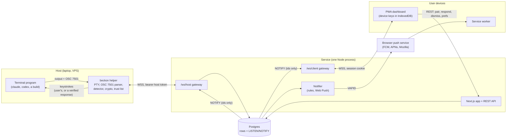

# Architecture

Beckon has two parts. The `beckon` helper is a Go binary that wraps a terminal program in a PTY, reads the
OSC 7501 status sequences it prints (or spots known prompts on screen when it prints none), and reports
status to the service over one outbound WebSocket. The service is a single Node process that serves the
Next.js web app (an installable PWA) and two WebSocket gateways, stores state in Postgres, fans changes out
with `LISTEN/NOTIFY`, and sends Web Push. Message content is end-to-end encrypted between the host and the
user's paired browsers: the server routes records by a small set of plaintext fields and never sees the
rest. A paired browser can answer a blocked prompt; the helper types the answer only after checking the
device's signature against keys it pinned locally.

This page describes what is built. [SPEC.md](../SPEC.md) is the original design (§4 to §9 cover the same
ground in more detail) and [SECURITY.md](../SECURITY.md) is the security model.

## Components



- **Helper to server:** one outbound WebSocket per `beckon run` process. The host never opens a port.
- **Server to helper:** responses and trust updates come back on the same socket.
- **Server to devices:** a WebSocket while the app is open, and Web Push when it is not.
- **Pairing:** with `beckon pair` running, a browser asks to pair through `POST /api/pair/request`, committing to
  its keys and a nonce. The server relays public keys both ways; `beckon pair` answers with its own nonce
  (`pair.nonce`), and the browser then reveals its nonce (`POST /api/pair/reveal`). Both sides show a six-word
  safety code computed from their own keys and both nonces, and trust is only ever
  recorded locally (the host's `trusted_devices.json`, the browser's IndexedDB). The server can remove a
  device from a host's view but never add one.

## Life of a record

```mermaid
sequenceDiagram
  participant P as Terminal program
  participant H as beckon helper
  participant S as Service
  participant DB as Postgres
  participant D as Paired browser

  P->>H: OSC 7501 state=working
  H->>S: record.upsert {state, revision, enc_body sealed to devices}
  S->>DB: upsert records, append record_events, NOTIFY
  DB-->>S: record.changed (ids)
  S-->>D: record.changed over /ws/client (if open)
  P->>H: OSC 7501 state=blocked kind=permission
  H->>S: record.upsert {state=blocked, revision+1, enc_body incl. response options}
  S->>DB: upsert, NOTIFY; notifier claims the transition
  S-->>D: Web Push (plaintext-safe fields and ids only)
  D->>S: GET record, decrypt enc_body locally, show buttons
  D->>S: POST /api/responses {enc_payload, signature, record_revision}
  S->>DB: store response (pending), NOTIFY response.created
  S->>H: response.deliver over the host socket
  H->>H: verify signature against pinned key, revision, freshness,<br/>nonce, offered option, no local typing since
  H->>P: type the option's keys (only keys the helper offered itself)
  H->>S: response.ack {status: applied | rejected_*}
  P->>H: OSC 7501 state=working, later done
  H->>S: record.upsert {state=done}
```

The helper assigns revisions: a counter per session. The server rejects an upsert older than the stored
revision, which keeps state correct when frames arrive out of order after a reconnect. On reconnect the
helper sends `hello` with every live session and record, a full resync.

## Code map

| Path | What lives there |
|---|---|
| `helper/cmd/beckon/main.go` | CLI entry point: `run`, `login`, `pair`, `devices`, `revoke`, `status`, `doctor`, `capture` |
| `helper/internal/ptyrun` | Runs the child in a PTY, passes bytes through, handles raw mode, resize and signals |
| `helper/internal/osc7501` | Streaming parser for OSC 7501 (copes with split input), the record store and its revisions |
| `helper/internal/detect` | Heuristic detector: renders output to a virtual screen (`charmbracelet/x/vt`) and matches known prompts; defaults in `detectors.default.toml` |
| `helper/internal/respond` | `[[respond]]` rules and the engine that verifies a delivered response before typing |
| `helper/internal/e2e` | Keys, envelopes (sealed to each device), response signatures, revocations, safety codes |
| `helper/internal/trust`, `pair` | The local trusted-device list and the pairing confirmation |
| `helper/internal/sink` | Where status goes: the network sink (WebSocket, reconnect, resync), JSON lines for `--debug` |
| `helper/internal/account`, `config` | Credentials, server URL, the config directory (`~/.config/beckon`) |
| `helper/internal/doctor`, `capture`, `safetext` | `beckon doctor`, fixture recording, stripping control and bidi characters from server-supplied text |
| `web/server.ts` | The custom Node server: Next.js, the gateways, `/healthz`, housekeeping timers, graceful drain |
| `web/src/gateway` | `host-gateway.ts`, `client-gateway.ts`, the zod wire schema (`protocol.ts`), `pubsub.ts` (`LISTEN/NOTIFY`) |
| `web/src/app` | Next.js App Router: the public site (`(site)`), the dashboard (`app/`), REST routes (`api/`), `install.sh` |
| `web/src/lib/notify` | Notifier: the pure rules (`rules.ts`), quiet hours and prefs, presence, Web Push sending, payload shape |
| `web/src/lib/crypto` | Browser crypto on libsodium, byte-compatible with the helper's |
| `web/src/lib/client` | Client state store, device keystore (IndexedDB), envelope decryption, push subscription |
| `web/src/lib` (rest) | Billing (Stripe), plans and limits, rate limits, retention, tokens, config checks |
| `web/src/sw` | The service worker: shows notifications, decrypts locally, handles action buttons |
| `web/src/db/schema.ts`, `web/drizzle/` | Drizzle schema and the SQL migrations |
| `testdata/crypto/vectors.json` | Interop vectors checked by both the Go and the TypeScript crypto |
| `deploy/` | Deployment targets: `vm/` (Docker Compose, Caddy, backups); see [deploy.md](deploy.md) |

## Data model

The schema is `web/src/db/schema.ts`. Ids are UUIDv7. Columns named `enc_*` hold envelopes the server
cannot read.

| Table | Holds |
|---|---|
| `users`, `accounts`, `verification_tokens` | Accounts and Auth.js sign-in (magic link, GitHub). A GitHub sign-in links to an existing account with the same address only if GitHub lists it as verified ([SECURITY.md](../SECURITY.md#linking-a-github-sign-in-to-an-existing-account)) |
| `hosts` | Machines running the helper: plaintext label, public keys, token hash |
| `devices` | Browsers and phones: name, public keys, push subscription, revocation |
| `pair_requests`, `device_revocations` | Pending pairings (10-minute expiry) and signed revocations |
| `sessions` | One per `beckon run`: `app`, `enc_meta` (argv, cwd, pid, label), start, end, exit code |
| `records` | Current state per `(session_id, path)`: state, kind, progress, `enc_body`, revision |
| `record_events` | Append-only state history, pruned to the plan's retention window |
| `responses` | Signed, encrypted answers and their status (pending, applied, `rejected_*`, expired) |
| `notification_prefs`, `notifications`, `client_presence` | Notification settings, one row per notified transition, which devices are visible |
| `device_codes` | `beckon login` device-code flow |
| `rate_limits`, `stripe_events` | Fixed-window counters; processed Stripe webhook ids |

## Wire protocol

All frames are JSON `{"t": "<type>", ...}` with binary fields in base64url. The authoritative schema is
`web/src/gateway/protocol.ts`; SPEC §9 has the design.

- **Host to server** (`/ws/host`, bearer host token): `hello`, `session.start`, `session.meta`, `record.upsert`,
  `record.clear`, `session.end`, `response.ack`, `pair.nonce`, `pair.confirmed`, `ping`.
- **Server to host:** `response.deliver`, `trust.update`, `pair.ack`, `pong`, and `error` (for example `plan_limit`).
- A helper's `ping` also marks its sessions seen. A live session not seen for 10 minutes is ended as lost
  (`web/src/lib/lost-sessions.ts`); a later `hello` from its helper brings it back.
- **Client** (`/ws/client`, session cookie): the server sends `snapshot`, `record.changed`,
  `record.removed`, `session.changed`, `host.presence`, `host.removed`, `response.status`, `devices.changed`,
  `pair.changed` and `toast`; the client sends `visibility`. The app's pages are rendered on the server
  with the same snapshot (`app/app/layout.tsx`, from the same user-scoped queries), so the inbox paints
  before the socket opens; the socket's snapshot then replaces it.
- **REST** under `/api`: inbox, hosts, sessions, records (dismiss), responses, pairing, devices, push,
  prefs, device code, account and billing.

## Security architecture

The threat model assumes the server and its database are fully compromised. Such a server can withhold,
delay or replay messages, show wrong plaintext routing fields and see metadata. It cannot read content,
forge or move ciphertext, get a device trusted, or cause keystrokes on a host.

- **Plaintext on the server:** host label, `app`, `state`, `kind`, `progress`, record `path`, timestamps,
  exit code, plus ids, device names and public keys needed for routing.
- **Never plaintext:** `msg`, `title`, argv, cwd, pid, the session's label and response contents. Envelope sizes do reveal
  approximate message length.
- **Keys:** Ed25519 for signing and X25519 for encryption, on the host (`~/.config/beckon/keys`, 0600) and
  in each browser (IndexedDB, wrapped by a non-extractable key).
- **Responses:** off unless a `[[respond]]` rule or a built-in detector offers options. The helper types
  only keys it offered, for a response signed by a device in its local trust list, for the current
  revision, fresh, never replayed, and only if nobody typed at the keyboard since.
- **Push payloads** carry only plaintext-safe fields and ids; the service worker decrypts content locally.

Details, including the tamper tests behind each claim: [SECURITY.md](../SECURITY.md).

## Tests

| Suite | Command | Covers |
|---|---|---|
| Go unit tests | `cd helper && go test -race ./...` | Parser, PTY, detector replays of recorded fixtures, network sink, crypto, trust, pairing, respond engine |
| Server integration | `cd web && npm test` | Gateways, REST, pub/sub reconnects, notifier and rules, push into a mock push service, billing, plans, retention, hardening, shutdown, `install.sh`, Go/TS crypto vectors |
| Tamper tests | part of `npm test` (`tests/tamper.test.ts`, `tests/responses-helper.test.ts`) | The real Go helper against a test playing a malicious server |
| End to end | `cd web && npm run test:e2e` | Playwright in Chromium: sign-in, login, pairing, live decrypted records, push, approve and deny, detectors, the site |

The web tests need the Postgres from `docker compose up -d db`; they create `beckon_test` and `beckon_e2e`.
CI (`.github/workflows/ci.yml`) runs all of them, then builds the production image and checks that it
starts, refuses unsafe settings and runs as a non-root user.

## Design decisions

- **A PTY wrapper rather than an agent plugin.** `beckon run -- <cmd>` works with any program and any
  terminal, and keeps the helper between the program and the keyboard, which is what lets it type a
  verified answer and notice when the user typed first. OSC 7501 gives exact status where a program
  supports it; the detector covers programs that do not yet.
- **End-to-end encryption with a server-blind content model.** Agent prompts contain code, paths and
  commands. The server only needs enough plaintext to route and rate-limit notifications, so everything
  else is sealed to device keys. This also lets self-hosters and users of the hosted service reason about
  the same trust boundary: the helper, which is MIT-licensed so it is easy to audit.
- **One Node process for the app and both gateways.** Next.js and `ws` share one HTTP server, one
  database pool and one deploy. There is no separate realtime service to run or keep in sync, which suits
  a small self-hosted install.
- **Postgres `LISTEN/NOTIFY` for fan-out.** Postgres is already required, so there is no Redis or queue.
  Notifications carry ids only (payloads are capped at 8 kB) and readers fetch rows. It also works across
  several instances: notifier decisions are claimed with inserts and advisory locks. It needs a direct
  (not pooled) connection; the server checks this at start-up and refuses to start otherwise.
- **Revisions assigned by the helper.** The helper is the source of truth for its own sessions, so a
  reconnect is a full resync and stale frames are simply ignored.
